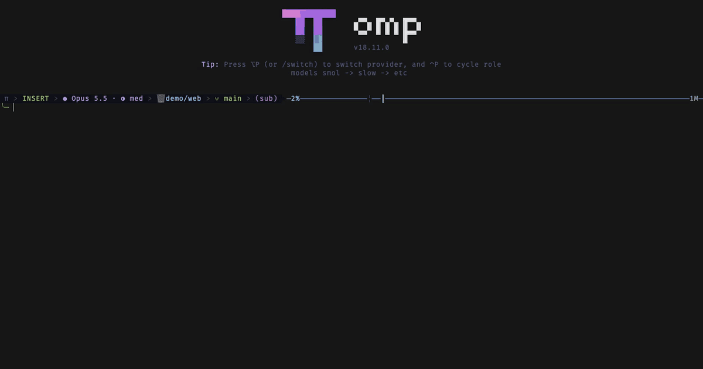
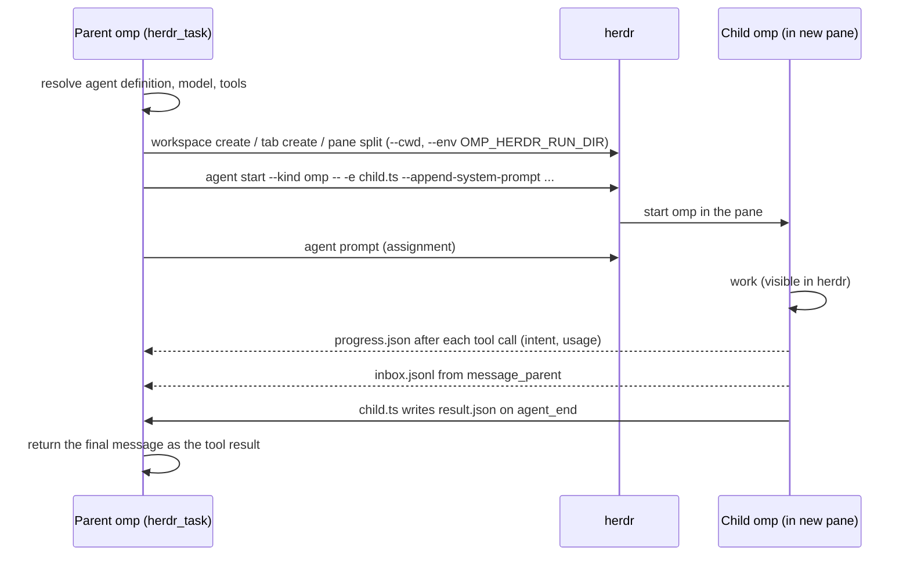

# omp-herdr-agents



An [omp](https://omp.sh) plugin that spawns omp subagents as interactive omp sessions in [herdr](https://herdr.dev). Each agent runs in its own working directory and gets its own herdr workspace, tab, or pane.

The built-in `task` tool runs subagents inside the parent process, in the parent's working directory. You cannot watch them or talk to them. `omp-herdr-agents` adds three tools. The first two share the contract of `task`:

- `herdr_task` spawns agents (`scout`, `task`, `reviewer`, or your own agent definitions) in any directory. The final message of each agent is the tool result.
- `herdr_send` sends a follow-up to an agent that `herdr_task` spawned. The agent keeps its context.
- `herdr_agents` lists the spawned agents, reads an agent's latest output or condensed transcript, interrupts its turn, or closes its pane.

Each child also gets a `message_parent` tool. A child calls `message_parent` to report a finding or ask a question while it keeps working. The message appears in the parent conversation; the parent answers with `herdr_send`.

The agents stay open in herdr after they finish, so you can read their work, type to them, or resume them.

## Requirements

- omp 18.10.4 or later.
- herdr 0.9 or later, with the omp running **inside a herdr pane** (`HERDR_ENV=1`). Outside herdr the plugin registers no tools.
- `omp` on the `PATH` of the herdr server, because herdr starts the child agents.
- Optional: the herdr omp integration (`herdr integration install omp`) gives herdr exact `working`/`idle`/`blocked` states for omp panes.

## Install

```sh
omp plugin install github:H3xept/omp-herdr-agents
# or, from a local checkout:
git clone https://github.com/H3xept/omp-herdr-agents && omp plugin link ./omp-herdr-agents
```

To try it for one session without installing:

```sh
omp -e /path/to/omp-herdr-agents/src/index.ts
```

## Usage

Ask omp for it in plain language, for example: "Use herdr_task to have a scout map the auth flow in ~/code/api". The model calls the tool like this:

```json
{
  "context": "We are adding SSO to the api service.",
  "tasks": [
    { "agent": "scout", "cwd": "~/code/api", "task": "Map the auth flow; list files and entry points." },
    { "agent": "task", "cwd": "../web", "name": "web-login", "placement": "tab", "task": "Add an SSO button to the login page." }
  ]
}
```

| Field | Meaning |
| --- | --- |
| `tasks[].cwd` | Working directory of the agent: absolute, `~/…`, or relative to the caller's directory. Required. |
| `tasks[].agent` | Agent type, as for `task`. Default: `task`. |
| `tasks[].task` | The complete, self-contained assignment. |
| `tasks[].name` | herdr agent name. herdr lowercases it and adds `-2`, `-3`, … when the name is in use. Default: the agent type. |
| `tasks[].placement` | `workspace` (default): a new herdr workspace. `tab`: a new tab in `workspace`, else in a workspace that already has a pane at `cwd`, else in the caller's workspace. `pane`: a split next to the caller's pane. |
| `tasks[].workspace` | herdr workspace id for `placement: "tab"`. |
| `context` | Shared background for every agent in the call. |
| `background` | `true`: the tool returns at once and the results arrive later as one message. Default: the omp `async.enabled` setting. |

`herdr_send` takes `name`, `message`, and `background`. It accepts only agents that `herdr_task` spawned in the same omp session.

## How it works



1. The parent resolves the agent type through omp's own agent discovery, so project, user, plugin, and bundled agents all work. The model follows `task.agentModelOverrides` and the agent's `model` patterns, then the parent's current model. Agent `tools` that the session does not know are dropped.
2. The parent writes the agent's role prompt, the shared context, and a completion contract to a run directory under the system temp directory. The child loads that file with `--append-system-prompt`.
3. herdr creates the pane in the target directory and starts `omp` there with `herdr agent start --kind omp`.
4. The parent submits the assignment with `herdr agent prompt`.
5. `src/child.ts`, loaded into the child with `-e`, writes `result.json` to the run directory each time the child's main agent finishes a turn. It waits while the child's own background jobs run. During a turn it updates `progress.json`: the intent of the latest tool call, the tool call count, and token and cost totals. `message_parent` appends to `inbox.jsonl`.
6. The parent polls the run directory once per second. It shows the progress line under each agent in the `herdr_task` row and forwards each new `inbox.jsonl` message once. It checks the agent with `herdr agent get` and reports `completed`, `failed`, `aborted`, or `lost` (the agent left its pane before it reported).
7. The parent records each spawned agent in its session file and its own delivery state in the run's `parent.json`. A parent that restarts with `--continue` or `--resume` restores its agents and still delivers pending background results.

## Behavior notes

- **Approvals.** Child agents run with `--approval-mode yolo`, like headless `task` subagents. Set `OMP_HERDR_APPROVAL_MODE` (for example `write` or `always-ask`) in the parent's environment to change this. A child that waits for approval keeps the parent waiting.
- **Steering.** You can type into a child pane while it works. omp treats that message as a steer: the agent reads it after its current tool call and keeps going in the same turn. The parent receives one result, at the end of the steered turn. A message to an idle child starts a new turn; `herdr_send` ignores that turn and waits for the reply to its own message. A `herdr_send` to a working agent also arrives as a steer.
- **Child messages.** A `message_parent` message starts a parent turn when the parent is idle. During a blocking `herdr_task` call, the parent reads the message only after the call returns. Use `background: true` when the parent must react while the agents work.
- **Background results.** Each agent's result arrives as its own message when that agent finishes, not after the whole batch.
- **Structured output.** For agents with an `output` schema (such as `scout`), the child is told to answer with one JSON object that matches the schema. Nothing validates it.
- **Cancellation.** When the parent aborts a blocking call, the plugin interrupts each child and stops waiting. `herdr_agents` with `action: "cancel"` interrupts one agent. Esc aborts a turn in omp, but in vim mode the first Esc only leaves insert mode. So the plugin sends Esc, waits until the child leaves `working`, and sends another Esc only while the child still works. The panes stay open.
- **Cleanup.** The plugin closes a pane only when you call `herdr_agents` with `action: "close"`. That action also removes the agent from the session, so a restored session does not bring it back. Run directories stay in the system temp directory.
- **`wait` tool.** omp's `wait` tool tracks omp jobs only. Background results from this plugin arrive as a message without it. Use `herdr_agents` with `action: "list"` to check on agents.
- **Large output.** Results longer than 30,000 characters are cut in the tool result. The full text stays in the run directory's `result.json`.

## Develop

```sh
bun install
bun run check   # tsc
bun test
```

`@oh-my-pi/pi-coding-agent` is a dev dependency for types and tests only. The plugin has no runtime dependencies: the omp extension loader resolves the host's `@oh-my-pi/pi-*` packages (`pi-coding-agent`, `pi-ai`, …) to the running omp. Import only from those packages; any other import needs a real entry in `dependencies`.

## License

MIT
